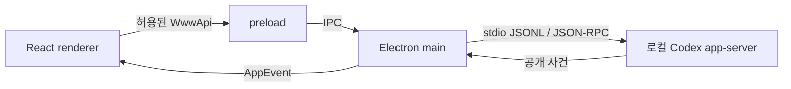

# WWW 코드 설계도

WWW는 Electron의 권한 있는 main, 제한된 preload, React renderer와 로컬 Codex app-server를 연결한다. 생태계의 **코드 설계도**는 현재 번들에 대응하는 TypeScript 모듈 참조를 보여 준다. 별도 **생태계 안내**는 개발 역할·작업 기록·후속 방향을 수동으로 설명한다.

## 코드 근거와 생성

정본 입력은 `src`의 `.ts`·`.tsx`와 `scripts/workflow`의 TypeScript, `scripts/workflow.ts`, `scripts/source-policy.ts`, `scripts/generate-architecture.ts`, `build.ts`다. 분석기는 TypeScript compiler API로 구문을 읽고 로컬 모듈을 해석한다. 주석에 적힌 import는 연결로 만들지 않는다.

각 노드에는 저장소 상대 경로·첫 행·전체 행 수·파일 SHA-256이 있다. 각 연결에는 참조하는 파일, 대상, 시작·끝 행, 원문 구문, specifier, 구문 종류와 타입/값 구분이 있다. 화면의 모듈 상세에서 해당 원문을 펼칠 수 있다. 화살표는 **참조하는 모듈 → 참조되는 모듈**이다.

`import type`, named type-only import, type-only export와 `import("...")` 타입 표현은 타입 전용 점선이다. 값과 타입이 섞인 import는 혼합 참조로 표시한다. 정적 import·re-export, 문자열 dynamic import·require·import-equals를 추출한다. 외부 패키지, 생성 JSON, 분석 범위 밖 참조는 사유를 남기고 노드에서 제외한다. 해석하지 못한 로컬 참조나 계산된 모듈 참조가 있으면 생성을 실패시킨다.

동일한 소스는 동일한 JSON과 digest를 만든다. 생성 시각을 넣지 않아 매 실행마다 변경되지 않는다. 전체 snapshot은 [architecture.generated.json](../src/architecture.generated.json), 분석 구현은 [generate-architecture.ts](../scripts/generate-architecture.ts)다.

```sh
node scripts/generate-architecture.ts
node scripts/generate-architecture.ts --check
npm run build
```

빌드는 번들 전에 snapshot을 생성한다. 생성 실패는 빌드 실패이며 이전 snapshot으로 계속 빌드하지 않는다. `--check`는 생성 파일을 덮어쓰지 않고 현재성과 결정성을 검사한다. 소스 편집 후 집중 테스트 전에는 생성 명령을 실행한다.

## 계층과 책임

계층·역할 이름은 사람이 정의한 분류다. 자동 추출한 것은 모듈과 참조이며 계층을 런타임 격리의 증명으로 사용하지 않는다.

| 계층 | 주요 모듈 | 책임 |
|---|---|---|
| 화면과 상호작용 | `renderer`, `chat-message`, `chat-row-state`, `native-activity-view`, `reports-view`, `ecosystem-view`, `input` | 화면 전환, 입력, 대화 행과 상세 탐색 |
| 상태와 투영 | `projection`, `chat-state`, `activity-sidebar`, `native-activity`, `native-chat`, `architecture`, `ecosystem` | 공개 사건·읽기 상태·모델·탐색 |
| 브리지와 계약 | `preload`, `shared` | 허용된 IPC 호출과 공용 타입 |
| Electron과 Native | `main`, `rpc`, `conversations`, `native-command`, 보고서·개발 서비스 | 프로세스, Native 통신, 저장 자료 접근 |
| 개발과 기록 | `scripts/workflow/*` | 권한, 작업 수명주기, 검증 증거, 검토, 보고서 |
| 빌드와 소스 정책 | `build.ts`, `workflow.ts`, `source-policy.ts`, `generate-architecture.ts` | 빌드, 작성 하네스, 분석 생성 |

개요에서는 계층 사이의 참조를 묶고 값·혼합/타입 전용 개수를 상세에 표시한다. 모듈 상세에서는 전체 배치를 유지하며 선택한 모듈과 직접 연결된 간선만 보여 준다. 파일 검색과 계층 필터로 범위를 좁힌다. 노드는 Tab·방향키·Enter·Space로 탐색하며 확대·축소·전체 보기·배경 드래그를 제공한다. 좁거나 낮은 창에서는 근거 패널을 그래프 아래에서 스크롤해 읽는다.

## 주요 실행 흐름과 권한 경계

아래 그림은 코드를 읽고 작성한 **의미 설명**이다. snapshot의 import 간선과는 다른 관계다.



- `src/preload.ts`의 `contextBridge.exposeInMainWorld`가 `WwwApi`만 노출한다. `src/main.ts`의 `ipcMain.handle`이 입력 확인과 실제 동작을 소유한다. renderer의 Node 접근을 추가하지 않는다.
- `src/main.ts`의 `connect`와 `src/rpc.ts`가 Native subprocess·JSONL 요청과 응답을 다룬다. renderer는 사건을 `projection`에 전달해 대화 블록을 만든다.
- `src/conversations.ts`가 Native 대화 목록·이력 복원을 맡는다. renderer의 대화별 초안·읽기 상태는 그래프와 분리되어 있다.
- 보고서와 개발 기능은 `reports-service`, `development`에서 workflow core에 연결된다. 별도 읽기 전용 보고서 판단 subprocess의 책임은 `report-judge`가 갖는다.

이 흐름의 정본 구조·권한 설명은 [ARCHITECTURE.md](ARCHITECTURE.md)다. 개별 import의 정확한 행 번호와 원문은 생성 JSON을 사용한다. 실행 시 IPC와 JSON-RPC 호출의 성공을 import로 입증하지 않는다.

## 범위와 한계

이 설계도는 빌드 시 소스 snapshot이며 현재 실행의 tracing이 아니다. 선택한 사용자 작업 폴더·서버 색인·외부 패키지 내부·테스트·vendor 라이브러리를 분석하지 않는다. 주입된 의존성, 문자열이 아닌 동적 참조, IPC·JSON-RPC·파일 접근의 실제 실행 관계를 자동 복원하지 않는다. 역할 설명은 파일 분류를 돕는 안내이며 함수 수준의 호출 그래프가 아니다.

집중 검사는 `bun test test/architecture.test.ts test/ecosystem.test.ts`, 화면 검사는 `node scripts/verify-architecture.ts`, 기존 대화 보존 검사는 `node scripts/verify-ecosystem.ts`다. 실제 실행 여부와 환경 제한은 [이번 작업 기록](work/Ecosystem/002-%EC%BD%94%EB%93%9C%20%EA%B8%B0%EB%B0%98%20%EC%95%84%ED%82%A4%ED%85%8D%EC%B2%98%20%EC%84%A4%EA%B3%84%EB%8F%84%EC%99%80%20%EA%B3%84%EC%B8%B5%ED%98%95%20Node%20%EA%B7%B8%EB%9E%98%ED%94%84/spec.md)에서 구분한다.
