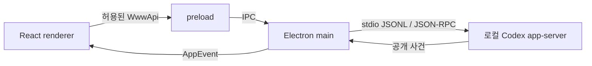

# WWW 코드 설계도

WWW는 Electron의 권한 있는 main, 제한된 preload, React renderer와 로컬 Codex app-server를 연결한다. WWW Node Map의 **기능·책임 지도**는 현재 번들에 대응하는 책임 계층과 명세·구현·검증 선언, 실제 TypeScript 모듈 참조를 보여 준다. 별도 **개념 처리 관계**는 개발 역할·작업 기록·후속 방향을 수동으로 설명하고 실제 source 근거가 있으면 같은 구조 ID의 담당 코드 지도로 연결한다.

## 코드 근거와 생성

구조 정본은 `docs/architecture/structure.json`의 `rootId`·`nodes`·정확한 대상의 `allowedDependencies`다. 명세 요구의 정본은 [architecture catalog](specs/architecture.md)다. 관리 소스의 첫 문장 앞 실제 JSDoc에 `@architecture arch.…`와 `@implements RESP-…`, 실제 테스트에는 `@verifies RESP-…`를 선언한다. 파일 이동은 책임 ID 변경 사유가 아니다. 하나의 책임에 여러 구현 파일을 연결할 수 있다. `src/architecture.ts`와 `src/architecture-tree.ts`는 같은 `arch.blueprint.layout` 책임을 공유한다.

계약 검사는 중복·미정의 ID·부모 누락과 순환·선언 누락·필수 구현/테스트 참조 누락·미허용 의존을 거부한다. 같은 ID 내부만 자동 허용하며 부모·자식도 명시 의존 대상이어야 한다. 등록의 완전성과 참조 일관성을 검사할 뿐 구현 의미의 정확성이나 테스트의 통과를 증명하지 않는다.

관리 범위는 `src`와 `scripts/workflow`의 TypeScript, `scripts/workflow.ts`, `scripts/source-policy.ts`, 지도 생성·계약·검사 모듈, `build.ts`다. TypeScript compiler API로 실제 import를 분석한다. 생성 자료의 `structure`는 `rootId/nodes/requirements/declarations/tests`와 digest를 포함한다. 파일별 nodes/edges는 실제 참조의 근거이며 구조 ID 정본을 대체하지 않는다. 각 선언·요구·테스트에는 파일과 선언 행, import에는 시작·끝 행과 원문이 있다. 파일 내용 해시도 생성 자료에 연결된다.

`import type`, named type-only import, type-only export와 `import("...")` 타입 표현은 타입 전용 점선이다. 값과 타입이 섞인 import는 혼합 참조로 표시한다. 정적 import·re-export, 문자열 dynamic import·require·import-equals를 추출한다. 외부 패키지, 생성 JSON, 분석 범위 밖 참조는 사유를 남기고 노드에서 제외한다. 해석하지 못한 로컬 참조나 계산된 모듈 참조가 있으면 생성을 실패시킨다.

동일한 소스는 동일한 JSON과 digest를 만든다. 생성 시각을 넣지 않아 매 실행마다 변경되지 않는다. 전체 snapshot은 [architecture.generated.json](../src/architecture.generated.json), 분석 구현은 [generate-architecture.ts](../scripts/generate-architecture.ts)다.

```sh
node scripts/generate-architecture.ts
node scripts/generate-architecture.ts --check
npm run build
```

빌드는 번들 전에 snapshot을 생성한다. 생성 실패는 빌드 실패이며 이전 snapshot으로 계속 빌드하지 않는다. `--check`는 생성 파일을 덮어쓰지 않고 현재성과 결정성을 검사한다. 소스 편집 후 집중 테스트 전에는 생성 명령을 실행한다.

## 계층과 책임

화면은 `arch.www`의 직계 자식부터 시작해 선택한 branch의 직계 자식으로 내려간다. 전체 → 대화 → 대화 세션 → 복원처럼 실제 부모 경로를 탐색한다. 현재 구조 ID와 ancestor breadcrumb·뒤로·전체 복귀를 표시한다. leaf는 그 ID에 등록된 명세 요구·구현 파일과 행·검증 참조 파일과 행을 읽는다. 검증 참조는 현재 테스트 결과 원장이 아니다.

구조 ID·요구 ID·제목·구현 및 테스트 파일 검색은 전역으로 찾고 대상 경로를 연다. 참조 대상 선택도 해당 부모 경로와 선택을 맞춘다. 현재 단계의 직계 자식 사이 import는 방향과 runtime/mixed/type별로 집계한다. 선택 범위 밖 참조는 상세에서 실제 원문으로 읽는다. 같은 책임을 공유하는 파일 사이 참조는 책임 경계선을 만들지 않는다.

`src/architecture-tree.ts`가 순수 계층·ancestor·검색·현재 단계 의존 집계·leaf 근거 모델을 소유한다. 기존 `src/architecture.ts`의 파일 참조 API와 배치는 호환을 위해 유지한다. 노드는 Tab·방향키·Home·End·Enter·Space로 탐색하고 확대·축소·크기 맞춤·배경 드래그를 제공한다. 좁거나 낮은 창은 상세 패널까지 내부 스크롤한다. 기존 어두운 팔레트와 시스템 글꼴·의미 토큰을 유지한다.

## 주요 실행 흐름과 권한 경계

아래 그림은 코드를 읽고 작성한 **의미 설명**이다. snapshot의 import 간선과는 다른 관계다.



- `src/preload.ts`의 `contextBridge.exposeInMainWorld`가 `WwwApi`만 노출한다. `src/main.ts`의 `ipcMain.handle`이 입력 확인과 실제 동작을 소유한다. renderer의 Node 접근을 추가하지 않는다.
- `src/main.ts`의 `connect`와 `src/rpc.ts`가 Native subprocess·JSONL 요청과 응답을 다룬다. renderer는 사건을 `projection`에 전달해 대화 블록을 만든다.
- `src/conversations.ts`가 Native 대화 목록·이력 복원을 맡는다. renderer의 대화별 초안·읽기 상태는 그래프와 분리되어 있다.
- 보고서와 개발 기능은 `reports-service`, `development`에서 workflow core에 연결된다. 별도 읽기 전용 보고서 판단 subprocess의 책임은 `report-judge`가 갖는다.

이 흐름의 정본 구조·권한 설명은 [ARCHITECTURE.md](ARCHITECTURE.md)다. 개별 import의 정확한 행 번호와 원문은 생성 JSON을 사용한다. 실행 시 IPC와 JSON-RPC 호출의 성공을 import로 입증하지 않는다.

## 범위와 한계

검증 참조는 닫힌 문법으로 확인한 정적 등록 선언이다. framework의 모든 value import를 호출사슬의 루트로 추적하지만, 수용하는 호출은 지원된 named API(가져오기 별칭 포함)와 Node 기본 test의 bare identifier 직접 호출뿐이다. 멤버·태그·호출 결과 재호출·namespace 등 미지원 사슬은 하위 전체를 제외한다. 일반 functionlike 본문은 탐색하지 않고 유효한 직접 suite의 inline callback body만 명시적으로 순회한다. unknown helper·foreach 콜백·간접 별칭·미호출 helper 안의 test는 등록으로 세지 않는다. 옵션은 설치 타입에서 확인한 필드의 직접 객체만 허용하며, Node skip/todo/only는 명시적 false만 수용한다. 객체 변수·spread·계산키·축약·getter·method·미지 필드는 거절하고 Bun의 숫자 리터럴 timeout과 두 옵션 위치를 지원한다. Node의 잘못된 세 번째 옵션 및 모호한 동적 이름 두 인자형은 제외한다. 일반 문장·block·반복 선언 순회는 유지하되 도달성·이름 가림·값 타입·실행 성공은 증명하지 않는다. 문자열 fixture는 AST 구문 경계를 검사하고 strict·runner 검증은 별도로 수행한다. 지원 서명·허용 필드와 한계의 정본은 [구조 ID 명세](specs/architecture.md)에 따른다.

이 설계도는 빌드 시 소스 snapshot이며 현재 실행의 tracing이 아니다. 선택한 사용자 작업 폴더·서버 색인·외부 패키지 내부·테스트의 실행 의미·vendor 라이브러리를 분석하지 않는다. 주입된 의존성, 문자열이 아닌 동적 참조, IPC·JSON-RPC·파일 접근의 실제 실행 관계를 자동 복원하지 않는다. 책임과 부모 관계는 명시한 계약이며 함수 수준의 호출 그래프가 아니다.

집중 검사는 `bun test test/architecture.test.ts test/architecture-tree.test.ts test/architecture-contract.test.ts test/architecture-harness.test.ts`, 화면 검사는 `node scripts/verify-architecture.ts`, 기존 대화 보존 검사는 `node scripts/verify-ecosystem.ts`와 `node scripts/verify-chat.ts`다. 화면 검사에는 root·중간·leaf·860/760px 캡처, 실제 키보드·포인터 입력, snapshot 수용을 포함한다. 포트 또는 GUI 실행이 제한된 환경의 실패는 GUI 미검증으로 기록한다.

`npm run check:architecture`와 전체 `npm run check`는 stale snapshot을 자동 수정하지 않고 거부한다. build는 생성 후 번들한다. 실제 typed 저작 하네스는 사전 오류를 작성 context로 전달하고 사후 미해결 계약·stale을 실패로 반환한다. BoxBox 검사·설정·승인과 독립 검토는 별도이며 이 구조 검사로 대체하지 않는다.


### 현재 단계의 가시성과 이동

직계 자식 배치는 `src/architecture-tree.ts`의 순수 `layoutResponsibilities`가 소유한다. 부모·자식은 모두 폭 360px·높이 112px이며 제목·역할 두 줄·구성 개수의 정보 위치를 유지한다. 구성 보기의 여백은 24px·열 사이 36px·행 사이 48px다. 자식 여섯 개 이상이며 1200px 이상이면 세 열, 자식 두 개 이상이며 804px 이상이면 두 열, 그 외는 한 열이다. 원문과 ID는 상세·툴팁에 보존한다.

기본 구성 보기의 포함 관계와 코드 의존 보기를 분리한다. 의존 보기에서는 표시할 간선 수 n에 따라 바깥 여백 24+12n, 열 통로 36+12n, 행 간격 48+6n px로 넓힌다. 간선별 6px 간격의 통로와 별도 포트를 사용하며 오른쪽에서 출발해 왼쪽으로 도착한다. 간선 번호는 방향·대상 제목·참조 종류별 수를 가진 목록에 대응한다. 책임 하나로 참조를 좁힐 수 있다. 간선이 많으면 지도가 커지므로 내부 스크롤하고, 강조 대상 선택으로 읽는 범위를 줄인다.

상세의 첫 화면은 정본 역할 설명·하위 구성·하위 포함 코드와 명세 수·담당 파일이다. 직접 등록 근거는 접힘 영역에 남기고, 범위 밖 참조는 참조하는 책임과 참조받는 책임을 나눠 같은 대상별 import 근거를 모은다. description은 사람이 코드와 문서를 대조해 작성한 책임 설명이며 import로 자동 추론한 실행 의미가 아니다. summary는 후손의 근거를 집계하되 원래 직접 evidence API는 유지한다.

계층 이동·명시적 크기 맞춤·창 resize에서는 자동 배율을 복구한다. 100% 미만으로 자동 축소하지 않아 좁거나 낮은 창은 내부 스크롤한다. 일반 검색·상세 렌더만으로 사용자 배율·이동을 초기화하지 않는다. fixture는 한 열·두 열·30개 간선의 포트 분리·노드 비관통과 하위 집계를 검사한다. 실제 Electron 검사는 부모/자식 규격, 구성/의존 전환·참조 강조·대화 세션의 역할/세 구성/파일·검색·키보드·배율·drag·860/760px 접근과 대화 보존을 관찰한다. 큰 지도의 전체가 viewport 안에 들어간다고 판정하지 않는다.

## 생성 JSON의 canonical 직렬화

개발·빌드 generator는 기존 WWW JSON 승인 근거를 확인한 설치 BoxBox 공개 CLI로 snapshot을 정렬한다. 머신별 설치·버전·SHA pin과 승인 registry 전체 SHA는 Git에서 무시하는 개발 로컬 설정이 소유한다. setup과 drift 진단은 [개발용 설치 계약](DEVELOPMENT.md#생성-snapshot의-개발용-boxbox-설치-계약)을 따른다. 앱 실행 중에는 CLI를 호출하지 않는다.

동일 staging 논리경로에서 dry-run·align·두 번째 align의 fixed point·source check를 통과해야 출력한다. check와 write의 canonical 함수는 같으며 stale check와 도구/승인 실패는 원본을 보존한다. parser fixture의 import 분석은 별도이므로 외부 CLI 설치를 요구하지 않는다.

수동 확대·축소 의도는 다음 계층 이동·창 resize·명시적 크기 맞춤까지 유지한다. viewport 관찰은 border box 기준이며 검색·상세 접기 등의 지연 크기 알림이 수동 배율을 덮지 않는다. 지도·채팅과 두 지도 탭의 왕복에서도 경로·선택·검색·배율·이동을 보존한다. 상세는 기본 접힘이며 닫기·Escape 후 선택 노드로 초점을 돌려준다. 숨긴 뷰의 0치수는 fit 입력으로 사용하지 않는다. 정본 부모와 직계 자식의 계층선, 실제 import, 타입 전용 관계를 구별한다. 이 변경의 실제 Electron 회귀 결과는 작업 증거에서 별도로 확인한다.

## 중앙 지도와 선택 요약

기능·책임 지도는 64px 화면 전환 rail을 기본으로 사용한다. 지도 상태인 navigationOpen이 탐색 열림을 소유하고 CSS는 보이는 생태계에서만 프로젝트·대화 목록을 접는다. renderer의 화면 전환 버튼은 숨기는 텍스트 label과 별도의 접근 가능한 이름·툴팁을 유지한다. 원래 DOM은 보존하므로 Chat·리포트로 복귀할 때 탐색과 대화 상태가 유지된다.

노드·검색·참조 선택은 닫힌 상세를 열지 않고 선택 요약을 갱신한다. 자세히 보기는 명시적인 열림이며 개념 안내에서 담당 코드 보기 역시 상세를 연다. 전체·ancestor·뒤로 이동도 사용자가 정한 상세 열림·접힘을 보존한다. 상단 제목·경로·조작은 압축하고 snapshot 식별 정보는 기본 화면에서 숨긴다. 실제 Electron probe는 기본 viewport 가로 90%·main 높이 60% 이상, rail 64px, 선택 후 폭 유지, 탐색 복구·상세 명시 열기·기존 상태 보존을 검사한다. 이 비율은 1440×900 기본 기능·책임 지도 기준이며 모든 창·개념 안내에 일반화하지 않는다.
