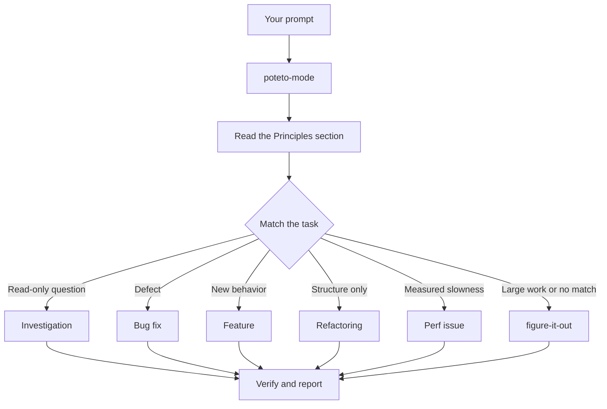

> 한국어 번역본: 고정 커밋 `63912a91d52c43946f974f2aaf661334a6116a82`의 원문을 한국어로 번역해 수정했습니다. 출처·원문 해시·라이선스는 `skill-library/sources.json`과 `skill-library/inventory.json`에 기록합니다.

# `/poteto-mode`를 통해 작업 라우팅하기

`/poteto-mode`는 관문입니다. 목표를 주면 23개 플레이북 중 하나를 매칭하고, 해당 플레이북의 단계를 할 일 목록에 복사한 다음, 단계에 필요한 다른 스킬을 호출합니다. 이 페이지에서는 좋은 프롬프트가 어떤 모습인지, 그리고 실제로는 얼마나 짧아도 되는지 배웁니다.


## 프롬프트에 일어나는 일



이 다이어그램은 일반적인 경로를 보여 줍니다. 지표를 점진적으로 개선하기, 런타임 증상과 캡처된 트레이스 진단하기, 프로토타입, 시각적 동일성, 스킬 작성과 평가, 자율 실행, PR 열기, PR이나 스택이 병합 준비 상태가 될 때까지 돌보기, 검증된 스택 출시하기, PR 큐나 스택을 자동 조종으로 실행하기, 프로젝트 규모 프로그램 오케스트레이션하기, 세션 이어받기, 안전하게 일시 중지하기, 다단계 계획, worktree 정리를 위한 플레이북도 있습니다. 전체 목록은 [플레이북 디렉터리](https://github.com/cursor/plugins/tree/63912a91d52c43946f974f2aaf661334a6116a82/pstack/skills/poteto-mode/playbooks)에 있습니다.

## 절차가 아니라 목표를 말하세요

명세를 작성할 필요는 없습니다. 무엇이 잘못됐는지 또는 무엇을 원하는지와 함께, 에이전트의 시간을 아껴 줄 이미 알고 있는 내용을 말하면 됩니다.

```text
/poteto-mode users get two notifications after a retry. repro first, then fix and verify.
```

이것은 Bug fix 프롬프트입니다. "repro first"는 예의상 덧붙인 말이 아니라 실제 제약이며, 플레이북은 이를 준수합니다. 할 일 목록이 Bug fix 단계로 채워지는 것을 지켜보세요. 건너뛴 단계는 `skip: <reason>`과 함께 계속 표시됩니다.

## 프롬프트에 들어갈 내용

유용한 프롬프트에는 최대 다섯 가지가 들어가며, 각각 한 문장에 담을 수 있습니다.

- **목표.** 무엇이 잘못됐는지 또는 무엇을 원하는지 말하세요.
- **완료 검사.** 통과하거나 실패할 수 있어야 합니다. "더 좋게 만들어 줘"와 "한 시간 동안 작업해 줘"는 검사가 아닙니다.
- **보고 싶은 증거.** 실제 명령 출력, 흐름을 담은 동영상, 저장된 값 또는 변경 전후 수치를 요청하세요.
- **이미 알고 있는 내용.** 증상, 재현 단계, 로그 한 줄 또는 링크가 있으면 에이전트의 탐색을 줄일 수 있습니다.
- **실제 제약.** "repro first", "don't change any code yet", "zero behavior change", "let me review before proceeding"은 각각 에이전트가 하는 일을 바꿉니다.

다섯 가지를 모두 담은 프롬프트는 다음과 같습니다.

```text
/poteto-mode the csv export drops its last row since yesterday's deploy. failing job id is 4812. repro first, then fix. done means the 60k-row fixture exports every row. show me the row counts before and after.
```

다음 두 가지는 빼는 편이 좋습니다.

- **방법.** 무엇을 달성할지 말하고, 여러분이 선택했을 경로보다 더 나은 경로를 에이전트가 찾을 여지를 남겨 두세요. 아래의 함정에서 다루는 스킬 목록도 마찬가지입니다.
- **원인에 대한 여러분의 추측, 적어도 처음에는.** 추측을 밝히면 탐색 범위가 여러분이 가리킨 곳으로 좁아집니다. 여러분의 짐작을 공유하기 전에 에이전트가 문제를 다시 진술하게 하세요.

긴 스레드나 모호한 버그처럼 잡음이 많은 보고서라면, 다시 진술하기를 첫 단계로 만드세요.

```text
/poteto-mode read this thread. restate the underlying issue in your own words, in plain english. don't change any code yet.
```

잘못 이해한 부분은 코드가 생기기 전에 다시 진술한 내용에서 드러납니다. 그 자리에서 바로잡으면 잘못된 수정 하나를 만드는 대신 메시지 하나만 쓰면 됩니다. 플레이북 없이 다시 진술만 하려면 [`/in-your-own-words`](https://github.com/cursor/plugins/blob/63912a91d52c43946f974f2aaf661334a6116a82/pstack/skills/in-your-own-words/SKILL.md)를 실행하세요. 이 스킬은 에이전트가 이해한 여러분의 목표와 해결하려는 문제를 다시 진술합니다.

프롬프트의 방향이 올바른지 확신이 서지 않으면 보내기 전에 [`/sharpen`](https://github.com/cursor/plugins/blob/63912a91d52c43946f974f2aaf661334a6116a82/pstack/skills/sharpen/SKILL.md)을 실행하세요.

```text
/sharpen write a migration guide for the v2 config format.
```

에이전트는 여러분이 요청하지 않았지만 최고의 전문가라면 할 일, 출발점으로 삼을 가장 원초적인 자료, 사용할 방법과 도구, 그리고 여러분이나 에이전트 외에 결과가 옳다는 것을 보여 줄 대상을 말합니다. 그런 다음 선택의 여지는 열어 둔 채, 더 넓어지지는 않지만 정확히 그 깊이를 요청하도록 프롬프트를 다시 작성합니다. 작업 자체를 수행하지는 않습니다. 다시 쓴 내용을 읽은 뒤, 예를 들어 `/poteto-mode`와 함께 보내세요.

## 후속 요청은 짧게 하세요

대화에 이미 맥락이 담겨 있다면 프롬프트는 거의 아무것도 없을 정도로 짧아집니다. 다음은 모두 충분합니다.

```text
/poteto-mode do it
```

```text
continue
```

```text
keep going until done
```

플레이북이 구조를 유지하고 Custom Mode가 매 턴 `/poteto-mode`를 맥락에 유지하므로 짧아도 통합니다. 시작 방법은 [pstack 설정하기](./01-setup.md#첫-작업-실행)에 나와 있습니다. 여러분의 말은 의도를 전달하고, 스킬은 엄밀함을 제공합니다.

## "new task"로 작업을 전환하세요

긴 채팅에는 이전 작업의 맥락이 쌓입니다. 주제를 바꿀 때는 그렇게 밝혀 주세요.

```text
/poteto-mode new task. figure out why the cache entry survives logout. don't change any code yet.
```

"new task"는 `/poteto-mode`에 이전 플레이북을 계속하지 말고 다시 매칭하라고 알립니다. "don't change any code yet"는 이 작업을 Investigation으로 고정합니다. 이 두 문구가 없으면 Feature 진행 중인 모드는 여러분의 질문을 다음 기능 단계로 취급하는 경향이 있습니다.

## 병렬 작업에는 각자의 머신을 제공하세요

한 컴퓨터의 한 저장소에서 여러 에이전트를 실행하면 작업 트리, 포트, 빌드 출력을 두고 충돌합니다. 가장 깔끔한 격리 방법은 [클라우드 하위 에이전트](https://cursor.com/docs/subagents#cloud-subagents)입니다. 각각 자체 VM과 브랜치를 받으므로 여러분의 머신을 건드리지 않고 의존성을 설치하고, 앱을 실행하고, 결과를 동영상으로 녹화할 수 있습니다. 작업 앞에 `/in-cloud`를 입력하거나 부모 채팅에 작업을 클라우드 하위 에이전트로 넘겨 달라고 요청하세요.

작업을 로컬에 유지해야 한다면 처음부터 worktree를 요청하세요.

```text
/poteto-mode new task. branch off <base> in a fresh worktree, then port the parser change there.
```

각 작업이 자체 브랜치와 worktree에 있으면 에이전트가 서로의 파일을 덮어쓰지 않습니다. Worktree는 디스크와 머신 자원을 소모하므로 노트북에서는 동시에 몇 개만 실행할 수 있습니다. [PR 열기 플레이북](https://github.com/cursor/plugins/blob/63912a91d52c43946f974f2aaf661334a6116a82/pstack/skills/poteto-mode/playbooks/opening-a-pr.md)은 코드 변경 시 이미 worktree에서 작업하므로, 대체로 특정 기준 브랜치나 위치가 중요할 때만 이를 말하면 됩니다.

Worktree는 쌓입니다. 디스크가 부족해지면 다음과 같이 요청하세요.

```text
/poteto-mode what's eating my disk? prune the worktrees that are safe to prune.
```

[Worktree 정리 플레이북](https://github.com/cursor/plugins/blob/63912a91d52c43946f974f2aaf661334a6116a82/pstack/skills/poteto-mode/playbooks/worktree-cleanup.md)은 모든 worktree를 병합 상태, 커밋되지 않은 작업, 아직 해당 worktree를 사용하는 채팅에 따라 분류합니다. 증거상 안전한 것만 삭제하고, 커밋되지 않은 작업이 있는 항목은 여러분의 결정을 기다립니다.

## 계속 실행되게 두세요

자리를 비울 때 완료의 의미를 말하고 떠나세요.

```text
/poteto-mode im stepping away. keep going until the migration check reports zero old callers. log your decisions.
```

나중에 검토할 작업은 [`/figure-it-out`](https://github.com/cursor/plugins/blob/63912a91d52c43946f974f2aaf661334a6116a82/pstack/skills/figure-it-out/SKILL.md)을 거치며, 이 스킬은 실행 단계를 설계하고 [`/show-me-your-work`](https://github.com/cursor/plugins/blob/63912a91d52c43946f974f2aaf661334a6116a82/pstack/skills/show-me-your-work/SKILL.md) 결정 로그를 유지합니다. 전체 야간 작업 계약은 [잠자는 동안 작업 실행하기](./07-overnight.md)에서 다룹니다.

**함정:** 프롬프트에 스킬을 열거하지 마세요("use /how, then /architect, then /arena..."). 플레이북이 이미 순서를 정하며, 손으로 작성한 순서는 플레이북이 유지했을 단계를 대개 재배치하거나 누락합니다. 특정 선택을 재정의하려는 경우에만 스킬 이름을 지정하세요.

전체 라우팅 규칙은 [`poteto-mode`](https://github.com/cursor/plugins/blob/63912a91d52c43946f974f2aaf661334a6116a82/pstack/skills/poteto-mode/SKILL.md) 자체를 읽어 보세요.

다음: [코드 이해하기](./03-understand.md).
