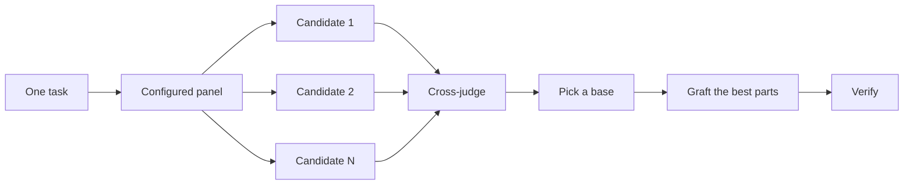

> 한국어 번역본: 고정 커밋 `63912a91d52c43946f974f2aaf661334a6116a82`의 원문을 한국어로 번역해 수정했습니다. 출처·원문 해시·라이선스는 `skill-library/sources.json`과 `skill-library/inventory.json`에 기록합니다.

# 코드를 작성하기 전에 설계하세요

어려운 설계를 한 번만 시도하면 모델이 처음 생각한 형태로 굳어집니다. `/architect`는 구현 전에 타입과 경계를 확정합니다. `/arena`는 같은 브리프에 대해 여러 시도를 실행하고 가장 좋은 부분을 합칩니다. `/interrogate`는 다른 모델이 결과를 깨뜨려 보게 합니다. 설계 종합이 아니라 범위 포괄이 작업의 목적이라면 `/swarm`이 작업 조각이나 경쟁 시도를 분산하고 그 결과를 집계합니다.

가장 흔한 두 가지 설계 실수는 에이전트의 첫 설계를 그대로 받아들이는 것과 코드로 검증하지 않은 계획을 다듬는 것입니다. 이 페이지는 둘 다 바로잡습니다. 코드를 통해 계획하세요. 프로토타입이 열린 질문에 답하고, README나 튜토리얼이 목표를 정하며, 문서화된 계획은 마지막에 나옵니다.


## `/architect`로 형태를 확정하세요

```text
/architect design the import pipeline before writing any code. i care most about how callers use it.
```

[`/architect`](https://github.com/cursor/plugins/blob/63912a91d52c43946f974f2aaf661334a6116a82/pstack/skills/architect/SKILL.md)는 먼저 기반을 다집니다. 설계가 건드리는 코드에 `/how`를 실행하고, 소유권이나 계층을 옮길 때는 `/why`를 실행합니다. 그런 다음 `/arena`를 실행해 서로 경쟁하는 설계 초안을 만듭니다. 각 초안에는 호출자의 사용법을 먼저 쓰고, 이어서 타입, 시그니처, 모듈 맵을 작성합니다.

기본적으로 종합된 설계에서 곧바로 구현으로 진행합니다. 설계를 먼저 보고 싶다면 그렇게 말하세요.

```text
/architect with checkpoint. stop and show me before implementing.
```

코드 작성을 시작했다고 해서 설계가 신성불가침인 것은 아닙니다. 구현 과정에서 관련 없는 여러 곳에 같은 우회책이 나타나거나, `any` 또는 강제 캐스트를 써야만 컴파일되는 타입이 드러나면 `/architect`는 이를 설계가 잘못됐다는 증거로 취급합니다. 주변을 임시로 고치는 대신 초안을 폐기하고 처음부터 다시 시작합니다.

## `/arena`로 여러 시도를 분산하세요

```text
/arena take my prompt to the arena verbatim. i want to compare their proposals with yours.
```

[`/arena`](https://github.com/cursor/plugins/blob/63912a91d52c43946f974f2aaf661334a6116a82/pstack/skills/arena/SKILL.md)는 기반이 되는 범용 도구입니다. N개의 하위 에이전트가 동일한 설계 또는 코드 브리프를 병렬로 시도하며, 각각 자체 worktree나 디렉터리에 작성합니다. 다른 모델 계열의 읽기 전용 심판이 평가 기준에 따라 모든 후보의 점수를 매깁니다. 다른 계열의 모델을 실행할 수 없으면 코디네이터가 심판을 건너뛰고 직접 기준안을 고릅니다. 코디네이터는 각 후보를 처음부터 끝까지 읽고, 기준안을 고른 뒤, 탈락한 후보의 가장 좋은 아이디어를 접목하고 결과를 검증합니다.



패널은 [`/setup-pstack`](https://github.com/cursor/plugins/blob/63912a91d52c43946f974f2aaf661334a6116a82/pstack/skills/setup-pstack/SKILL.md) 구성에서 가져오며, 작업별로 조정할 수 있습니다. 결정이 중요할 때는 후보를 더 많이, 그렇지 않을 때는 더 적게 요청하세요.

```text
/arena this, 5 candidates. the cache key format is expensive to change later.
```

## `/swarm`으로 작업 조각과 경쟁 시도를 포괄하세요

```text
/swarm check every package under packages/ against its check.sh. one worker per package. one report.
```

[`/swarm`](https://github.com/cursor/plugins/blob/63912a91d52c43946f974f2aaf661334a6116a82/pstack/skills/swarm/SKILL.md)은 N개의 워커를 독립적인 작업 조각, 범위 매트릭스, 관문 레인, 탐색 파티션 또는 명시된 경쟁 후보에 분산합니다. 각 워커는 자체 범위와 검사를 받은 다음 `PASS`, `ISSUES` 또는 `BLOCKED`를 보고합니다. 부모는 워커를 기다린 뒤 누락이나 이탈을 포함한 간결한 보고서 하나를 반환합니다.

병렬 처리가 범위를 넓히거나 독립적인 검사를 경쟁시킬 수 있을 때 사용하세요. `/arena`는 모든 워커에게 같은 설계 또는 코드 브리프를 제공한 다음 기준안을 고르고 가장 좋은 부분을 접목합니다. `/swarm`은 작업 조각을 포괄하거나 미리 선언된 선택 규칙에 따라 경쟁을 실행합니다. 기준안 선택과 접목 절차는 사용하지 않습니다.

## `/interrogate`로 깨뜨려 보세요

```text
/interrogate the whole branch, but skeptically. no nitpicks unless it's an actual bug or regression.
```

[`/interrogate`](https://github.com/cursor/plugins/blob/63912a91d52c43946f974f2aaf661334a6116a82/pstack/skills/interrogate/SKILL.md)는 변경과 의도를 구성된 모델의 적대적 검토자에게 제공하고, 각 검토자는 실제 코드를 실행해 이를 깨뜨리려 합니다. 검토자마다 서로 다른 실패를 찾아냅니다. 명령을 다시 실행했을 때 의도를 깨는 실패가 나타나는 발견만 살아남습니다. 보고서는 검증된 모든 발견과 이를 찾아낸 검토자를 나열한 다음, 각 검토자가 버린 내용과 그 이유를 기록하며, 아무것도 적용하지 않습니다.

Dropped 목록도 읽으세요. 판정을 재정의할 수 있습니다.

## 논쟁하는 대신 프로토타입을 만드세요

첫 번째 설계를 절대 그대로 받아들이지 마세요. 몇 가지를 요청하고, 눈으로 확인할 수 있는 증거를 바탕으로 고르세요.

```text
/poteto-mode prototype a few options for the new dropdown menu. take screenshots or videos for me to compare.
```

[프로토타입 플레이북](https://github.com/cursor/plugins/blob/63912a91d52c43946f974f2aaf661334a6116a82/pstack/skills/poteto-mode/playbooks/prototype.md)은 스크래치 디렉터리에 폐기할 수 있는 초안을 만들고, 하나의 전환 장치 뒤에 여러 변형을 배치하며, 각 변형을 구동하고 스크린샷이나 측정 시간을 캡처합니다. UI뿐 아니라 동작과 알고리즘에도 사용할 수 있습니다. 프로토타입은 코드로 하는 계획입니다. 에이전트가 질문하는 대신 무언가를 실행해 스스로 열린 질문에 답하게 하며, 여러분이 생각하지 못했을 선택지를 위한 여지도 남깁니다.

같은 아이디어를 실제 설계로 확장할 수 있습니다. `/architect`와 프로토타입을 함께 사용하고 검토 게이트를 유지하세요.

```text
/poteto-mode we need rate limiting for external webhooks. /architect it first, and answer open questions with prototypes. let me review before proceeding.
```

추상적인 계획에 적대적 검토자를 낭비하지 마세요. `/interrogate`는 실행으로 입증되지 않은 모든 발견을 버리므로, 뒷받침하는 코드가 없는 계획에는 깨뜨릴 것이 거의 없습니다. 프로토타입으로 질문을 해결한 다음 만들어진 결과를 검토하세요.

## 공유 코드라면 README를 먼저 작성하세요

다른 코드가 사용할 패키지나 API라면 사용자가 읽을 문서부터 시작하세요.

```text
/poteto-mode write a tutorial for how i would use the new config package first. then /teach me why it beats the current one.
```

튜토리얼을 먼저 작성하면 호출자의 관점을 우선하게 됩니다. 가상의 사용자에게 API를 설명하고 거꾸로 구현을 도출합니다. 이 문서는 에이전트가 자신의 작업을 확인할 구체적인 목표도 됩니다. 문서 자체가 중요하다면 [`/technical-writing`](https://github.com/cursor/plugins/blob/63912a91d52c43946f974f2aaf661334a6116a82/pstack/skills/technical-writing/SKILL.md)을 지정하여 튜토리얼이 참고 자료와 설명을 동시에 담으려다 성격이 흐려지지 않게 하세요.

## 설계가 확정된 후 계획하세요

pstack에는 의도적으로 계획 스킬이 없습니다. 문서화된 계획이 필요하다면 설계가 확정된 뒤 요청하세요.

```text
/poteto-mode turn this design into a plan. small verifiable PRs, each with its own verification steps.
```

[다단계 계획 플레이북](https://github.com/cursor/plugins/blob/63912a91d52c43946f974f2aaf661334a6116a82/pstack/skills/poteto-mode/playbooks/multi-phase-plan.md)은 남은 열린 질문을 프로토타입으로 해결한 다음, PR마다 한 섹션을 작성하며 각 섹션 끝에는 변경이 작동한다는 증거를 둡니다. 테스트 스위트 통과만으로는 그 증거로 인정되지 않습니다. 계획 자체가 결과물입니다. 이 플레이북은 계획을 구현하지 않으며, 다음에 어떤 실행 플레이북이 이를 실행해야 하는지 밝힙니다.

마이그레이션이라면 프롬프트에 기준을 명시하세요.

```text
/poteto-mode plan the migration of our ui library to the new styling system. small verifiable PRs, each with visual regression checks. the result must match the original exactly, bugs included.
```

"bugs included"는 마이그레이션 도중 조용히 문제를 고치는 것을 막습니다. 그렇게 고치면 이전 출력과 새 출력을 비교할 수 없게 됩니다. 여러 날에 걸친 프로젝트라면 다른 에이전트가 진행 중인 작업을 볼 수 있도록 당분간 계획을 저장소에 커밋할 수 있습니다. 작업이 반영되면 삭제하세요.

## 작업에 어느 정도의 설계 작업이 필요할까요?

모든 변경에 이것이 필요한지 궁금할 수 있습니다. 아닙니다. 대부분의 변경에는 전혀 필요하지 않습니다. 대략적인 단계는 다음과 같습니다.

- 완료된 작은 변경이 확실하지 않다면 `/interrogate`만 필요합니다.
- 함수 경계를 넘거나 소유권을 옮기는 변경에는 `/arena`를 함께 실행하는 `/architect`를 적용할 가치가 있습니다.
- 이름, 형식, 알고리즘처럼 독립적인 여러 시도가 도움이 되는 단독 결정에는 `/arena`를 직접 사용합니다.
- 범위 매트릭스, 병렬 검사 모음 또는 후보가 선언된 경쟁에는 `/swarm`을 사용합니다.
- 레이아웃, 측정 시간, 접근법처럼 무언가를 실행해 답할 수 있는 열린 질문에는 논쟁이 아니라 프로토타입을 사용합니다.
- 되돌리는 비용이 큰 논쟁적인 설계에는 `/architect`를 사용한 다음 출시 전에 `/interrogate`를 실행합니다.
- 여러 PR에 걸친 작업에는 설계가 확정된 뒤 작성한 계획이 필요합니다.

`/poteto-mode`는 이미 이 단계를 적용합니다. 경계를 넘는 작업은 자체적으로 `/architect`를 실행하므로, 기본값보다 더 많거나 적은 검토를 원할 때 주로 이들을 직접 사용하게 됩니다.

다음: [변경 빌드하고 정리하기](./05-build-and-clean.md).
