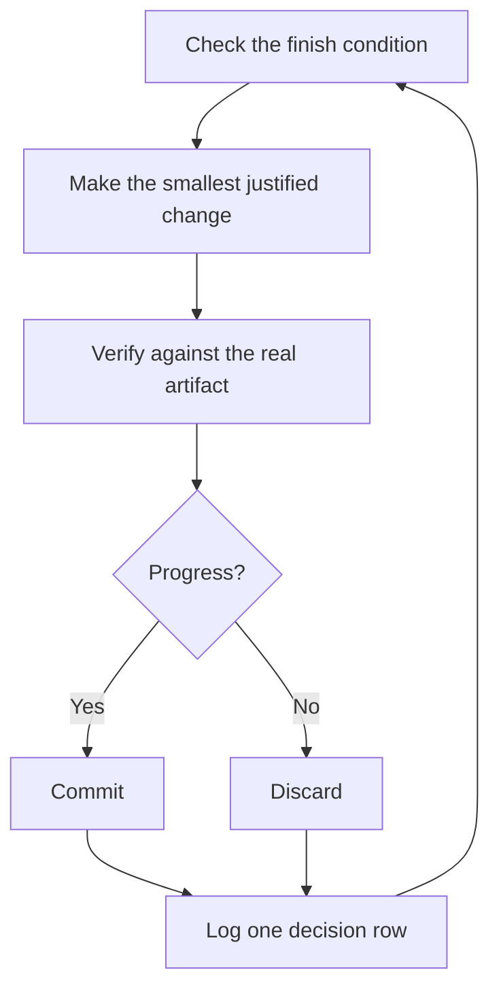

> 한국어 번역본: 고정 커밋 `63912a91d52c43946f974f2aaf661334a6116a82`의 원문을 한국어로 번역해 수정했습니다. 출처·원문 해시·라이선스는 `skill-library/sources.json`과 `skill-library/inventory.json`에 기록합니다.

# 잠든 동안 작업 실행하기

앞선 모든 작업의 결실이 여기에 있습니다. 자기 작업을 스스로 검증한다고 믿을 수 있는 에이전트라면 어려운 작업을 맡기고 자리를 비울 수 있습니다. 이를 안전하게 만드는 것은 막연한 기대가 아닙니다. 검사할 수 있는 완료 조건, 격리된 worktree 또는 클라우드 에이전트, 아침에 감사할 결정 기록입니다.


## 루프 전에 신뢰 얻기

신뢰하지 않는 루프는 검증되지 않은 작업을 더 빨리 만들어낼 뿐이며, 반복할 때마다 혼란이 커집니다. 실행한 채 자리를 비우기 전에 신뢰를 얻었는지 확인하십시오.

- 좋은 결과가 어떤 것인지 알 수 있도록 작업을 직접 한 번 해봤거나 에이전트가 수행하는 모습을 지켜봤습니다.
- 에이전트에 검증 스킬, 프로파일러, 로그처럼 여러분이 직접 사용할 도구와 신호가 있습니다.
- 각 단계가 작업을 입증하며, 작업이 기준에 미달하면 흐름을 중단할 수 있습니다.
- 대화 기록 몇 개를 읽고 반복되는 실패를 도구, 스킬 또는 검사로 바꿨습니다.

네 가지 조건이 모두 충족된 뒤에만 루프를 자율화하십시오. 그전까지는 지켜보면서 실행하십시오.

## 야간 작업 계약

좋은 인계에는 목표, 완료 조건, 권한, 탈출구가 있습니다. 길 필요는 없습니다.

```text
/poteto-mode im going to bed. migrate every caller to the new parser in a fresh worktree off <base>.
done means zero old callers, all parser fixtures pass, old api deleted.
keep a decision log. don't ask me before committing.
/loop until done. if you're truly stuck after a few hours, stop and write up why.
```

각 줄이 어떤 이점을 주는지 살펴봅시다.

- "im going to bed"는 세션 재정의입니다. 에이전트는 질문을 멈추고 계속 진행합니다.
- "done means..."는 목표를 매 반복마다 실행할 수 있는 검사로 바꿉니다.
- "fresh worktree off `<base>`"는 실행이 열어둔 다른 작업과 충돌하지 않게 합니다.
- "don't ask me before committing"은 에이전트가 아니면 기다렸을 권한을 미리 답해 둡니다.
- `/loop`는 pstack 스킬이 아니라 Cursor에 내장된 깨우기 메커니즘입니다. [자율 실행 플레이북](https://github.com/cursor/plugins/blob/63912a91d52c43946f974f2aaf661334a6116a82/pstack/skills/poteto-mode/playbooks/autonomous-run.md)은 이벤트나 주기 신호에 따라 완료 조건을 다시 확인하는 데 이를 사용합니다.
- 탈출구를 두면 진짜 막다른 길에서 멈추고 이유를 기록할 수 있습니다. 이는 여덟 시간 동안 목표를 창의적으로 재해석하는 것보다 낫습니다.

자리를 비운 뒤 이 작업을 검토하게 되므로, `/poteto-mode`는 코드 작성 전에 실행 단계를 설계하고 결정 기록을 연결하는 [`/figure-it-out`](https://github.com/cursor/plugins/blob/63912a91d52c43946f974f2aaf661334a6116a82/pstack/skills/figure-it-out/SKILL.md)을 거치게 합니다.

의도적으로 실행을 멈추려면 에이전트에게 일시 중지하라고 하거나, 곧 오프라인 상태가 되거나 Cursor를 다시 시작할 것이라고 알리십시오. [안전하게 일시 중지하기 플레이북](https://github.com/cursor/plugins/blob/63912a91d52c43946f974f2aaf661334a6116a82/pstack/skills/poteto-mode/playbooks/pause-safely.md)은 현재 단계를 완료하거나 되돌리고, 작업 중 체크포인트를 커밋하며, 재개 메모를 작성합니다. 새 대화는 세션 이어받기 플레이북을 통해 그 메모에서 작업을 이어갑니다. "keep going"이라고 말해도 일시 중지는 절대 촉발되지 않습니다.

## 루프가 밤새 하는 일



매 반복마다 변경 하나, 검사 하나, 기록 행 하나입니다. 도움이 되지 않은 변경은 남겨두지 않고 폐기합니다. 정체는 중단이 아니라 방향 전환을 뜻하며, 성공을 선언하려고 완료 조건을 슬쩍 완화하지 않습니다.

## 아침 감사

[`/show-me-your-work`](https://github.com/cursor/plugins/blob/63912a91d52c43946f974f2aaf661334a6116a82/pstack/skills/show-me-your-work/SKILL.md)는 실행을 검토 가능하게 만듭니다. 각 행은 시간, 단계, 결정, 이유, 증거 포인터, 결과를 `decisions.tsv`의 TSV로 기록합니다. 여러 실행이 디렉터리를 공유할 때는 `.audit/<task-slug>.tsv`를 사용합니다. 기본적으로 로컬에 유지됩니다. 작업이 충분히 야심 차서 검토자가 결과를 신뢰하려면 그 과정이 필요할 때 커밋하십시오.

돌아오면 검토 형식으로 실행 결과를 요청하십시오.

```text
/show-me-your-work catch me up on what you did last night
```

스킬이 요약을 돌려주기 전에 다른 모델 계열의 검토자를 생성해 기록과 대화 내용을 읽게 하며, 응답은 살펴봐야 할 사항을 나열하는 Attention 섹션으로 끝납니다. 그 섹션을 먼저 읽은 다음, 섹션이 가리키는 기록 행을 읽으십시오. 밤새의 모든 내용을 다시 읽는 것이 아니라 결정을 감사하는 것입니다.

감사 대신 빠른 상태 확인이 필요하면 작업을 실행한 대화에서 [`/ketchup`](https://github.com/cursor/plugins/blob/63912a91d52c43946f974f2aaf661334a6116a82/pstack/skills/ketchup/SKILL.md)을 실행하십시오. 읽기만 수행하며, 마지막 메시지 이후 달라진 내용을 작업 중 생성된 스크린샷과 작은 다이어그램을 곁들여 평이한 말로 알려줍니다. 그런 다음 병합, 승인, 선택지 결정처럼 여러분을 기다리는 각 판단을 추천안, 증거, 위험과 함께 나열하므로 응답만 보고 결정할 수 있습니다.

## 밤에 단일 작업이 아니라 대기열이 있을 때

위 계약은 작업 하나를 완료 조건 하나까지 진행합니다. 어떤 밤에는 독립적인 변경 대기열이나 전체 프로그램처럼 더 많은 일이 있습니다. 세 가지 플레이북이 같은 신뢰를 확장합니다.

[Autopilot-full](https://github.com/cursor/plugins/blob/63912a91d52c43946f974f2aaf661334a6116a82/pstack/skills/poteto-mode/playbooks/autopilot-full.md)은 독립적인 PR 대기열을 병합까지 진행합니다. 각 PR에는 빌드부터 병합까지 책임지는 소유자 에이전트 한 명이 배정되며, 어떤 소유자도 자신의 판단만으로 병합하지 않습니다. 새로운 검증자 무리가 소유자의 코드 준비 완료 head를 검사합니다. 이후의 rebase나 사소한 수정에는 새 검증자 한 명을 배정하고, 새로운 동작이나 큰 신규 diff가 있을 때만 전체 무리를 다시 호출합니다. 병합될 패치에 대한 깨끗한 판정만 병합을 허가합니다.

```text
/poteto-mode full autopilot on this queue. each item is independent. i want them merged by morning.
```

[Autopilot-stack](https://github.com/cursor/plugins/blob/63912a91d52c43946f974f2aaf661334a6116a82/pstack/skills/poteto-mode/playbooks/autopilot-stack.md)은 병합을 제외한 Autopilot-full입니다. 검증된 각 PR과 그 판정을 받아보며, 직접 검토하고 반영합니다. PR은 자신이 의존하는 PR 위에만 쌓입니다. 병합 전에 직접 확인하려면 Autopilot-full 대신 선택하십시오.

```text
/poteto-mode autopilot these five changes, but don't merge. i'll land them in the morning.
```

[Orchestrate](https://github.com/cursor/plugins/blob/63912a91d52c43946f974f2aaf661334a6116a82/pstack/skills/poteto-mode/playbooks/orchestrate.md)는 단일 에이전트보다 오래 지속되는 프로그램, 즉 여러 날, 다수의 스택형 PR, 하나의 상설 조정자 대화 아래 있는 하위 에이전트 집단을 위한 것입니다. 조정자는 각 작업을 어떤 에이전트가 수행할지 결정하고 결과를 검사하며, 직접 코드를 작성하지 않습니다. 한 에이전트가 한 세션 안에 끝낼 수 있다면 플레이북 자체가 위의 야간 작업 계약으로 되돌려 보냅니다.

```text
/poteto-mode orchestrate the store migration. own it until every package is converted and merged. i'll check in twice a day.
```

## 여러 프로젝트를 병렬로 실행하기

[Cursor Project](https://cursor.com/blog/projects)는 조정자 에이전트 한 명에게 지속되는 스레드를 제공합니다. 조정자는 코드를 작성하지 않습니다. 기본적으로 클라우드에서 실행되는 하위 에이전트를 지휘하므로 노트북이 닫혀 있어도 작업은 계속됩니다. Orchestrate 플레이북이 기대하는 형태가 바로 이것입니다. 조정자에게 보내는 프롬프트를 `/poteto-mode`로 시작하면 생성되는 하위 에이전트가 플레이북을 따릅니다.

몇 가지 습관이 도움이 됩니다.

- 기능, 마이그레이션, 성능 개선, 기술 부채 정리처럼 각 작업 묶음마다 별도의 Project를 두십시오. 여러 개를 나란히 실행할 수 있습니다.
- 완료된 대화를 포함해 관련 대화를 Project로 끌어오십시오. 모든 에이전트의 맥락이 됩니다.
- 각 PR을 병합하기 전에 검증자 무리를 배정하고, Autopilot-stack이나 Autopilot-full이 대기열을 맡게 하십시오.
- 조정자에게 데이터로 뒷받침되는 계획을 요청하고, 질문하기 전에 프로토타입으로 열린 질문에 답하게 하십시오.

하나의 프롬프트로 조사부터 실행까지 전체 Project를 맡길 수 있습니다.

```text
/poteto-mode refactor this repo so its architecture is more agent friendly. use /correct and /architect on past commits and review comments to find the mistakes agents make most here. use /recall for context from past chats. answer open questions with prototypes instead of asking me. come back with a plan backed by real data. once i approve it, run it with autopilot-stack or autopilot-full, and ask me which.
```

## 루프가 스스로 시작하게 하기

위의 모든 루프는 여전히 여러분이 시작하기를 기다립니다. 예약 또는 이벤트 기반 자동화는 그 단계를 없앱니다. 소프트웨어 유지보수는 이 방식에 잘 맞는 단계, 즉 보고서 분류, 재현, 수정, 수정 검증으로 나뉩니다. 두 가지 규칙이 이러한 흐름을 신뢰할 수 있게 합니다.

- 모든 단계가 흐름을 중단할 수 있습니다. 분류 단계는 보고된 내용이 예상된 동작이라고 판단할 수 있고, 재현 단계는 재현에 실패할 수 있으며, 수정 담당자는 변경이 너무 위험하다고 판단할 수 있습니다. 이 결과들은 모두 유용합니다. 잘못된 작업이 다음 단계로 넘어가 되돌리는 비용이 커지는 것을 막기 때문입니다.
- 모든 단계가 증거를 인계합니다. 재현 단계는 깨진 상태의 스크린샷과 영상을 첨부하고, 수정 단계는 전후 증거를 첨부합니다. 그러면 사람은 코드 한 줄을 읽기 전에 에이전트가 올바른 문제를 수정했는지 확인할 수 있습니다.

pstack은 Slack 이슈 보고서를 위한 비활성 [자동화 팩](https://github.com/cursor/plugins/blob/63912a91d52c43946f974f2aaf661334a6116a82/pstack/automations/benny/README.md)으로 이를 제공합니다. 한 자동화가 각 보고서를 분류합니다. 다른 자동화는 확인된 버그를 재현하고 작은 초안 수정을 준비할 수 있습니다. 설정하려면 에이전트에게 [`FOR_AGENTS.md`](https://github.com/cursor/plugins/blob/63912a91d52c43946f974f2aaf661334a6116a82/pstack/automations/benny/FOR_AGENTS.md)를 읽게 하고 대상 저장소를 지정하십시오.

**주의할 점:** 기간은 완료 조건이 아닙니다. "work on this for 4 hours"는 에이전트가 검사할 대상을 주지 않으며, 결과 대신 네 시간 동안의 움직임만 보게 됩니다. `/loop`에 참 또는 거짓으로 판정할 수 있는 조건을 주십시오.

다음: [원칙 이름으로 방향 잡기](./08-principles.md).
