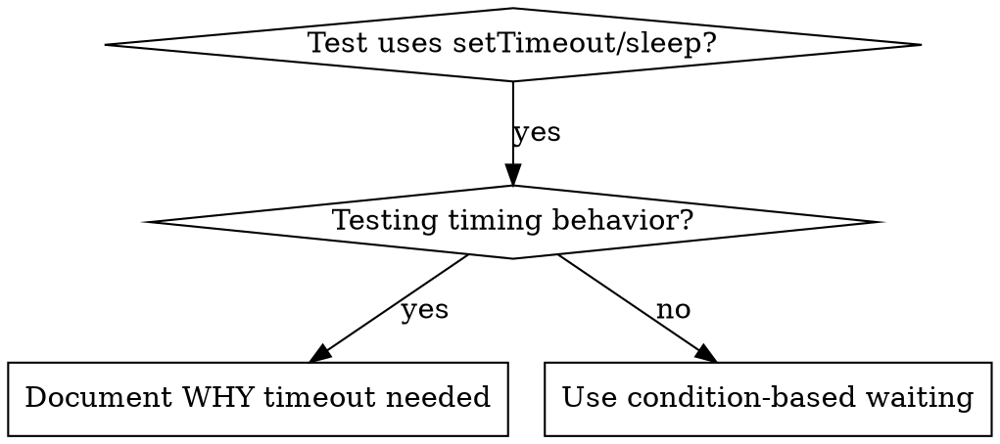

> 한국어 번역본: 고정 커밋 `22f0b463e7a5e579904dd6211a520321035526f7`의 원문을 한국어로 번역해 수정했습니다. 출처·원문 해시·라이선스는 `skill-library/sources.json`과 `skill-library/inventory.json`에 기록합니다.

# 조건 기반 대기

## 개요

불안정한 테스트는 흔히 임의의 지연으로 타이밍을 추측합니다. 이는 빠른 머신에서는 테스트가 통과하지만 부하가 걸리거나 CI에서는 실패하는 경쟁 상태를 만듭니다.

**핵심 원칙:** 걸리는 시간에 대한 추측이 아니라, 관심 있는 실제 조건을 기다립니다.

## 사용 시점



**다음 경우에 사용:**
- 테스트에 임의 지연이 있음(`setTimeout`, `sleep`, `time.sleep()`)
- 테스트가 불안정함(가끔 통과하고 부하 시 실패)
- 병렬 실행 시 테스트가 시간 초과됨
- 비동기 작업이 완료될 때까지 기다리는 중

**다음 경우에는 사용하지 않음:**
- 실제 타이밍 동작을 테스트하는 경우(debounce, throttle 간격)
- 임의 시간 초과를 사용할 경우 항상 이유를 문서화

## 핵심 패턴

```typescript
// ❌ BEFORE: Guessing at timing
await new Promise(r => setTimeout(r, 50));
const result = getResult();
expect(result).toBeDefined();

// ✅ AFTER: Waiting for condition
await waitFor(() => getResult() !== undefined);
const result = getResult();
expect(result).toBeDefined();
```

## 빠른 패턴

| 시나리오 | 패턴 |
|----------|---------|
| 이벤트 대기 | `waitFor(() => events.find(e => e.type === 'DONE'))` |
| 상태 대기 | `waitFor(() => machine.state === 'ready')` |
| 개수 대기 | `waitFor(() => items.length >= 5)` |
| 파일 대기 | `waitFor(() => fs.existsSync(path))` |
| 복잡한 조건 | `waitFor(() => obj.ready && obj.value > 10)` |

## 구현

범용 폴링 함수:
```typescript
async function waitFor<T>(
  condition: () => T | undefined | null | false,
  description: string,
  timeoutMs = 5000
): Promise<T> {
  const startTime = Date.now();

  while (true) {
    const result = condition();
    if (result) return result;

    if (Date.now() - startTime > timeoutMs) {
      throw new Error(`Timeout waiting for ${description} after ${timeoutMs}ms`);
    }

    await new Promise(r => setTimeout(r, 10)); // Poll every 10ms
  }
}
```

실제 디버깅 세션의 도메인별 헬퍼(`waitForEvent`, `waitForEventCount`, `waitForEventMatch`)를 포함한 전체 구현은 이 디렉터리의 `condition-based-waiting-example.ts`를 참조하세요.

## 흔한 실수

**❌ 너무 빠른 폴링:** `setTimeout(check, 1)` - CPU를 낭비함
**✅ 수정:** 10ms마다 폴링

**❌ 시간 초과 없음:** 조건이 충족되지 않으면 무한 루프
**✅ 수정:** 명확한 오류와 함께 항상 시간 초과를 포함

**❌ 오래된 데이터:** 루프 전에 상태를 캐시
**✅ 수정:** 최신 데이터를 위해 루프 안에서 getter 호출

## 임의 시간 초과가 올바른 경우

```typescript
// Tool ticks every 100ms - need 2 ticks to verify partial output
await waitForEvent(manager, 'TOOL_STARTED'); // First: wait for condition
await new Promise(r => setTimeout(r, 200));   // Then: wait for timed behavior
// 200ms = 2 ticks at 100ms intervals - documented and justified
```

**요구 사항:**
1. 먼저 트리거 조건 대기
2. 추측이 아닌 알려진 타이밍에 기반
3. 이유를 설명하는 주석

## 실제 영향

디버깅 세션(2025-10-03) 기준:
- 3개 파일에서 불안정한 테스트 15개 수정
- 통과율: 60% → 100%
- 실행 시간: 40% 단축
- 경쟁 상태 완전 제거
