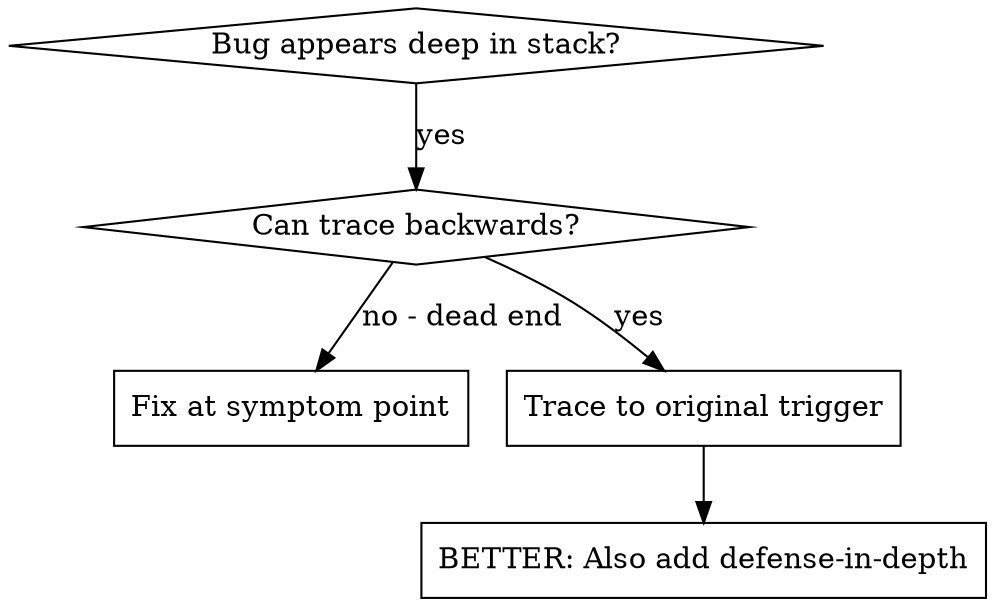
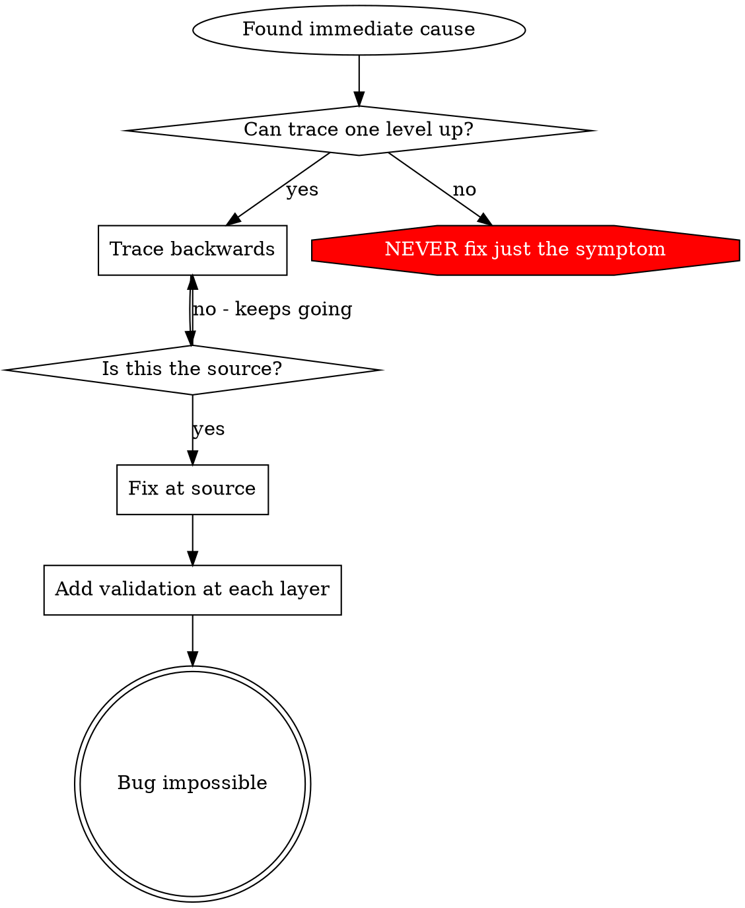

> 한국어 번역본: 고정 커밋 `22f0b463e7a5e579904dd6211a520321035526f7`의 원문을 한국어로 번역해 수정했습니다. 출처·원문 해시·라이선스는 `skill-library/sources.json`과 `skill-library/inventory.json`에 기록합니다.

# 근본 원인 추적

## 개요

버그는 종종 호출 스택 깊은 곳에서 나타납니다(잘못된 디렉터리의 git init, 잘못된 위치에 생성된 파일, 잘못된 경로로 열린 데이터베이스). 본능적으로 오류가 나타난 곳을 수정하게 되지만, 이는 증상을 다루는 것입니다.

**핵심 원칙:** 호출 체인을 거슬러 올라가 원래 트리거를 찾은 다음, 원인 지점에서 수정하세요.

## 사용 시점



**다음 경우에 사용하세요:**
- 오류가 실행 깊은 곳에서 발생합니다(진입점이 아님)
- 스택 추적에 긴 호출 체인이 표시됩니다
- 잘못된 데이터의 발생 지점이 불분명합니다
- 어떤 테스트/코드가 문제를 유발하는지 찾아야 합니다

## 추적 과정

### 1. 증상 관찰
```
Error: git init failed in ~/project/packages/core
```

### 2. 직접 원인 찾기
**어떤 코드가 이를 직접 유발하나요?**
```typescript
await execFileAsync('git', ['init'], { cwd: projectDir });
```

### 3. 질문: 누가 이를 호출했나요?
```typescript
WorktreeManager.createSessionWorktree(projectDir, sessionId)
  → called by Session.initializeWorkspace()
  → called by Session.create()
  → called by test at Project.create()
```

### 4. 계속 위로 추적
**어떤 값이 전달되었나요?**
- `projectDir = ''` (빈 문자열!)
- `cwd`의 빈 문자열은 `process.cwd()`로 해석됩니다
- 그것이 소스 코드 디렉터리입니다!

### 5. 원래 트리거 찾기
**빈 문자열은 어디서 왔나요?**
```typescript
const context = setupCoreTest(); // Returns { tempDir: '' }
Project.create('name', context.tempDir); // Accessed before beforeEach!
```

## 스택 추적 추가

수동으로 추적할 수 없을 때는 계측을 추가하세요:

```typescript
// Before the problematic operation
async function gitInit(directory: string) {
  const stack = new Error().stack;
  console.error('DEBUG git init:', {
    directory,
    cwd: process.cwd(),
    nodeEnv: process.env.NODE_ENV,
    stack,
  });

  await execFileAsync('git', ['init'], { cwd: directory });
}
```

**중요:** 테스트에서는 `console.error()`를 사용하세요(logger는 표시되지 않을 수 있음)

**실행하고 캡처하세요:**
```bash
npm test 2>&1 | grep 'DEBUG git init'
```

**스택 추적을 분석하세요:**
- 테스트 파일 이름을 찾습니다
- 호출을 유발한 줄 번호를 찾습니다
- 패턴을 식별합니다(같은 테스트? 같은 매개변수?)

## 어떤 테스트가 오염을 유발하는지 찾기

테스트 중 무언가가 나타나지만 어떤 테스트 때문인지 모를 때:

이 디렉터리의 이분 탐색 스크립트 `find-polluter.sh`를 사용하세요:

```bash
bash ./find-polluter.sh '.git' 'src/**/*.test.ts'
```

테스트를 하나씩 실행하고 첫 번째 오염 유발 지점에서 멈춥니다. 사용법은 스크립트를 참조하세요.

## 실제 예시: 비어 있는 projectDir

**증상:** `packages/core/`(소스 코드)에 `.git`가 생성됨

**추적 체인:**
1. `git init`가 `process.cwd()`에서 실행됨 ← 빈 cwd 매개변수
2. 빈 projectDir로 WorktreeManager가 호출됨
3. Session.create()가 빈 문자열을 전달함
4. 테스트가 beforeEach 전에 `context.tempDir`에 접근함
5. setupCoreTest()가 처음에는 `{ tempDir: '' }`를 반환함

**근본 원인:** 빈 값에 접근하는 최상위 변수 초기화

**수정:** beforeEach 전에 접근하면 예외를 던지는 getter로 tempDir를 변경했습니다

**심층 방어도 추가했습니다:**
- 계층 1: Project.create()가 디렉터리를 검증
- 계층 2: WorkspaceManager가 비어 있지 않음을 검증
- 계층 3: NODE_ENV 가드가 tmpdir 외부의 git init을 거부
- 계층 4: git init 이전의 스택 추적 로깅

## 핵심 원칙



**오류가 나타난 곳만 절대 수정하지 마세요.** 원래 트리거를 찾기 위해 거슬러 추적하세요.

## 스택 추적 팁

**테스트에서:** logger가 억제될 수 있으므로 logger가 아니라 `console.error()`를 사용하세요
**작업 전:** 실패한 뒤가 아니라 위험한 작업 전에 로그를 남기세요
**컨텍스트 포함:** 디렉터리, cwd, 환경 변수, 타임스탬프
**스택 캡처:** `new Error().stack`은 전체 호출 체인을 표시합니다

## 실제 영향

디버깅 세션(2025-10-03)에서:
- 5단계 추적을 통해 근본 원인을 찾음
- 원인 지점에서 수정함(getter 검증)
- 4개의 방어 계층을 추가함
- 1847개 테스트 통과, 오염 없음
