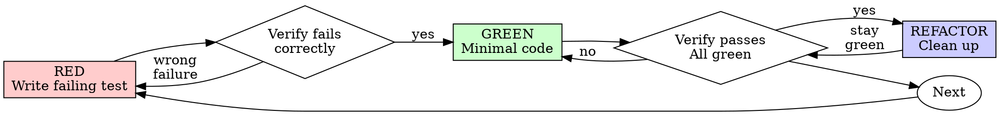

> 한국어 번역본: 고정 커밋 `22f0b463e7a5e579904dd6211a520321035526f7`의 원문을 한국어로 번역해 수정했습니다. 출처·원문 해시·라이선스는 `skill-library/sources.json`과 `skill-library/inventory.json`에 기록합니다.


# 테스트 주도 개발(TDD)

## 개요

먼저 테스트를 작성하세요. 실패하는 것을 확인하세요. 통과할 최소 코드를 작성하세요.

**핵심 원칙:** 테스트가 실패하는 것을 보지 않았다면, 올바른 것을 테스트하는지 알 수 없습니다.

**규칙의 문구를 어기는 것은 그 취지도 어기는 일입니다.**

## 사용 시점

**항상:**
- 새 기능
- 버그 수정
- 리팩터링
- 동작 변경

**예외(사람 파트너에게 물어보세요):**
- 일회용 프로토타입
- 생성된 코드
- 구성 파일

"이번 한 번만 TDD를 건너뛸까?"라고 생각하나요? 멈추세요. 그것은 합리화입니다.

## 철칙

```
먼저 실패하는 테스트 없이는 실제 제품 코드를 작성하지 않는다
```

테스트 전에 코드를 작성했나요? 삭제하세요. 처음부터 다시 시작하세요.

**예외 없음:**
- "참고"용으로 보관하지 마세요
- 테스트를 작성하면서 이를 "개조"하지 마세요
- 보지 마세요
- 삭제는 삭제를 의미합니다

테스트로부터 새롭게 구현하세요. 끝입니다.

## Red-Green-Refactor



### RED - 실패하는 테스트 작성

발생해야 하는 일을 보여 주는 최소 테스트 하나를 작성하세요.

<Good>
```typescript
test('retries failed operations 3 times', async () => {
  let attempts = 0;
  const operation = () => {
    attempts++;
    if (attempts < 3) throw new Error('fail');
    return 'success';
  };

  const result = await retryOperation(operation);

  expect(result).toBe('success');
  expect(attempts).toBe(3);
});
```
명확한 이름, 실제 동작 테스트, 한 가지
</Good>

<Bad>
```typescript
test('retry works', async () => {
  const mock = jest.fn()
    .mockRejectedValueOnce(new Error())
    .mockRejectedValueOnce(new Error())
    .mockResolvedValueOnce('success');
  await retryOperation(mock);
  expect(mock).toHaveBeenCalledTimes(3);
});
```
모호한 이름, 코드가 아니라 목을 테스트함
</Bad>

**요구 사항:**
- 하나의 동작
- 명확한 이름
- 실제 코드(불가피하지 않으면 목 없음)

### RED 검증 - 실패하는 것을 확인

**필수입니다. 절대 건너뛰지 마세요.**

```bash
npm test path/to/test.test.ts
```

다음을 확인하세요:
- 테스트가 오류가 아니라 실패합니다
- 실패 메시지가 예상한 내용입니다
- 오타가 아니라 기능이 없어서 실패합니다

**테스트가 통과하나요?** 기존 동작을 테스트하고 있는 것입니다. 테스트를 고치세요.

**테스트에 오류가 나나요?** 오류를 고치고, 올바르게 실패할 때까지 다시 실행하세요.

### GREEN - 최소 코드

테스트를 통과할 가장 단순한 코드를 작성하세요.

<Good>
```typescript
async function retryOperation<T>(fn: () => Promise<T>): Promise<T> {
  for (let i = 0; i < 3; i++) {
    try {
      return await fn();
    } catch (e) {
      if (i === 2) throw e;
    }
  }
  throw new Error('unreachable');
}
```
통과에 필요한 만큼만
</Good>

<Bad>
```typescript
async function retryOperation<T>(
  fn: () => Promise<T>,
  options?: {
    maxRetries?: number;
    backoff?: 'linear' | 'exponential';
    onRetry?: (attempt: number) => void;
  }
): Promise<T> {
  // YAGNI
}
```
과도한 설계
</Bad>

기능을 추가하거나, 다른 코드를 리팩터링하거나, 테스트를 넘어 "개선"하지 마세요.

### GREEN 검증 - 통과하는 것을 확인

**필수입니다.**

```bash
npm test path/to/test.test.ts
```

다음을 확인하세요:
- 테스트가 통과합니다
- 다른 테스트도 계속 통과합니다
- 출력이 깨끗합니다(오류, 경고 없음)

**테스트가 실패하나요?** 테스트가 아니라 코드를 고치세요.

**다른 테스트가 실패하나요?** 지금 고치세요.

**"다른 테스트"는 작성한 파일만이 아니라 프로젝트의 테스트 모음을 뜻합니다.** 작성한 테스트의 녹색 실행 결과가 전체 모음의 녹색 결과는 아닙니다. 변경을 완료했다고 하기 전에 작업에서 테스트 파일 하나만 지정했더라도 프로젝트의 테스트 명령(그 저장소가 사용하는 `pytest`, `npm test`, `cargo test` 등)을 실행하세요. 작업에 명시한 범위는 산출물의 경계이지 검증의 경계가 아닙니다. 그 실행에서 표시되는 모든 실패(본인이 유발하지 않은 실패 포함)는 이름을 명시해 보고해야 합니다. 스크롤로 지나간 빨간 테스트를 언급하지 않는 것은 누락으로 보고를 허위로 만드는 것입니다.

### REFACTOR - 정리

녹색 결과 이후에만:
- 중복 제거
- 이름 개선
- 헬퍼 추출

테스트를 녹색으로 유지하세요. 동작을 추가하지 마세요.

### 반복

다음 기능에는 다음 실패 테스트를 작성하세요.

## 좋은 테스트

| 품질 | 좋음 | 나쁨 |
|---------|------|-----|
| **최소** | 한 가지. 이름에 "and"가 있나요? 나누세요. | `test('validates email and domain and whitespace')` |
| **명확함** | 이름이 동작을 설명함 | `test('test1')` |
| **의도를 보여 줌** | 원하는 API를 보여 줌 | 코드가 해야 할 일을 흐림 |

테스트를 작성하거나 변경할 때는 정직한 테스트를 유지하는 규칙을 위해 [writing-good-tests.md](writing-good-tests.md)를 읽으세요:
- 테스트를 실패하게 할 프로덕션 변경을 작성 전에 이름 붙이세요
- 목 동작이 아니라 실제 동작을 단언하세요
- 테스트 전용 코드는 프로덕션 클래스가 아니라 테스트 유틸리티에 두세요
- 의존성을 목으로 대체하기 전에 그 부수 효과를 이해하세요

## 흔한 합리화

| 변명 | 현실 |
|--------|---------|
| "테스트하기에 너무 단순해" | 단순한 코드도 망가집니다. 테스트는 30초 걸립니다. |
| "나중에 테스트할게" | 나중에 작성한 테스트는 즉시 통과합니다. 이는 아무것도 증명하지 않습니다. 잘못된 것을 테스트하거나, 동작 대신 구현을 테스트하거나, 잊어버린 경계 사례를 놓칠 수 있습니다. 실패하는 것을 본 적이 없으므로 버그를 잡을 수 있음을 증명한 적도 없습니다. 테스트 우선은 그 실패를 강제합니다. |
| "나중 테스트도 같은 목표를 달성해(의식이 아니라 정신)" | 나중 테스트는 "이것이 무엇을 하는가?"에 답하고, 테스트 우선은 "이것이 무엇을 해야 하는가?"에 답합니다. 나중에 작성한 테스트는 이미 작성한 코드에 편향됩니다. 발견했을 사례가 아니라 기억한 사례를 검증합니다. 테스트가 작동한다는 증거 없는 커버리지입니다. |
| "이미 수동으로 테스트했어" | 수동 테스트는 임시방편입니다. 무엇을 다뤘는지 기록이 없고, 코드가 바뀌면 다시 실행할 방법이 없으며, 압박 속에서 사례를 잊기 쉽습니다. "해 보니 동작했다"는 포괄적이라는 뜻이 아닙니다. 자동화된 테스트는 매번 같은 방식으로 실행됩니다. |
| "X시간을 삭제하는 것은 낭비야" | 매몰 비용 오류입니다. 어느 쪽이든 그 시간은 이미 사용되었습니다. 실제 선택지는 TDD로 다시 작성하기(높은 신뢰도)와 유지하고 나중에 테스트를 덧붙이기(낮은 신뢰도, 버그 가능성 높음)입니다. 신뢰할 수 없는 코드를 유지하는 것이 낭비입니다. |
| "참고용으로 보관하고 테스트를 먼저 작성할게" | 그것을 개조하게 됩니다. 그것은 나중 테스트입니다. 삭제는 삭제를 의미합니다. |
| "먼저 탐색해야 해" | 괜찮습니다. 탐색 결과는 버리고 TDD로 시작하세요. |
| "테스트가 어려움 = 설계가 불분명" | 테스트의 말을 들으세요. 테스트하기 어려움 = 사용하기 어려움입니다. |
| "TDD가 나를 느리게 할 거야" | TDD는 실용적인 경로입니다. 커밋 전에 버그를 잡고, 회귀를 막으며, 두려움 없이 리팩터링하게 합니다. "실용적인" 지름길은 프로덕션에서 디버깅한다는 뜻이며, 더 느리지 더 빠르지 않습니다. |
| "수동 테스트가 더 빨라" | 수동은 경계 사례를 증명하지 못합니다. 변경할 때마다 다시 테스트하게 됩니다. |
| "기존 코드에는 테스트가 없어" | 이를 개선하고 있는 것입니다. 기존 코드에 테스트를 추가하세요. |

## 위험 신호 - 멈추고 처음부터 다시 시작

- 테스트 전에 코드 작성
- 구현 후 테스트
- 테스트가 즉시 통과
- 테스트가 왜 실패했는지 설명할 수 없음
- 테스트를 "나중에" 추가함
- "이번 한 번만"이라고 합리화함
- "이미 수동으로 테스트했어"
- "나중 테스트도 같은 목적을 달성해"
- "정신이지 의식이 아니야"
- "참고용으로 보관" 또는 "기존 코드 개조"
- "이미 X시간을 썼으니 삭제는 낭비야"
- "TDD는 독단적이고, 나는 실용적이야"
- "이건 다르니까..."

**이 모두는 다음을 의미합니다: 코드를 삭제하세요. TDD로 처음부터 다시 시작하세요.**

## 예시: 버그 수정

**버그:** 비어 있는 이메일이 허용됨

**RED**
```typescript
test('rejects empty email', async () => {
  const result = await submitForm({ email: '' });
  expect(result.error).toBe('Email required');
});
```

**RED 검증**
```bash
$ npm test
FAIL: expected 'Email required', got undefined
```

**GREEN**
```typescript
function submitForm(data: FormData) {
  if (!data.email?.trim()) {
    return { error: 'Email required' };
  }
  // ...
}
```

**GREEN 검증**
```bash
$ npm test
PASS
```

**REFACTOR**
필요하다면 여러 필드의 검증을 추출하세요.

## 검증 체크리스트

작업을 완료로 표시하기 전:

- [ ] 새 함수/메서드마다 테스트가 있음
- [ ] 구현하기 전에 각 테스트가 실패하는 것을 확인함
- [ ] 각 테스트가 예상한 이유로 실패함(오타가 아니라 기능 부재)
- [ ] 각 테스트를 통과시키기 위한 최소 코드를 작성함
- [ ] 모든 테스트가 통과함
- [ ] 출력이 깨끗함(오류, 경고 없음)
- [ ] 테스트가 실제 코드를 사용함(불가피한 경우에만 목)
- [ ] 경계 사례와 오류를 다룸

모든 항목을 확인할 수 없나요? TDD를 건너뛴 것입니다. 처음부터 다시 시작하세요.

## 막혔을 때

| 문제 | 해결책 |
|---------|----------|
| 어떻게 테스트할지 모르겠음 | 바라는 API를 작성하세요. 먼저 단언을 작성하세요. 사람 파트너에게 물어보세요. |
| 테스트가 너무 복잡함 | 설계가 너무 복잡합니다. 인터페이스를 단순화하세요. |
| 모든 것을 목으로 대체해야 함 | 코드 결합도가 너무 높습니다. 의존성 주입을 사용하세요. |
| 테스트 설정이 너무 큼 | 헬퍼를 추출하세요. 여전히 복잡한가요? 설계를 단순화하세요. |

## 디버깅 통합

버그를 찾았나요? 이를 재현하는 실패 테스트를 작성하세요. TDD 주기를 따르세요. 테스트는 수정을 증명하고 회귀를 방지합니다.

테스트 없이 버그를 절대 수정하지 마세요.

## 최종 규칙

```
프로덕션 코드 → 해당 테스트가 존재하며 먼저 실패했음
Otherwise → not TDD
```

사람 파트너의 허가 없이는 예외가 없습니다.
